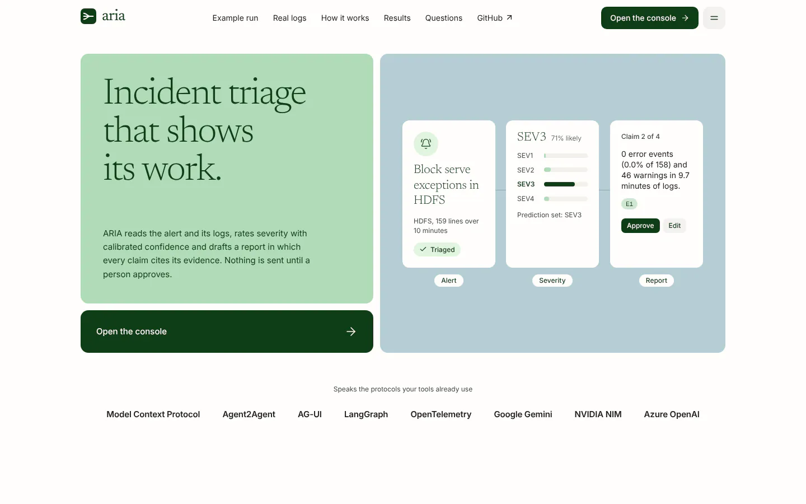

# ARIA

[](https://github.com/ManavParmar1609/ARIA/actions/workflows/ci.yml)

ARIA does the first pass of incident triage. It reads an alert or a burst of log lines and works
out what failed, how severe it is and which past incidents look the same. It then drafts an
incident report in which every claim cites the log lines behind it, and pauses for a person to
approve, edit or reject the report before anything is published or sent.

ARIA runs offline with no API keys. Set an NVIDIA NIM key and the agents write with open models
on NVIDIA's hosted API. Azure OpenAI and any OpenAI-compatible server work the same way: switching
is a config change.



> [!IMPORTANT]
> The measured results below come from **semi-synthetic** incidents: real log lines from the
> public Loghub samples, composed into incidents by ARIA's scenario builder. They show how ARIA
> behaves on that data, not how accurate it is on your production incidents. See
> [Limitations](#limitations) and the [data card](docs/data-card.md).

## What happens to an incident

1. **Intake.** An Alertmanager, Grafana or generic webhook, the periodic log scan, the console,
   the CLI, or another agent (over A2A or AG-UI) starts a run. Alerts that share a group key
   within five minutes join one run, so an alert storm becomes one incident.
2. **Parse.** Lines are redacted (secrets removed, IP and e-mail addresses pseudonymised),
   checked for prompt injection, and grouped into templates with Drain. Large inputs fan out
   over parallel shards.
3. **Severity.** Rules give a floor. A calibrated model gives probabilities and a conformal
   prediction set. An LLM may adjudicate, but only between the labels in that set.
4. **Investigate and retrieve.** An investigator tests hypotheses with read-only log tools.
   Hybrid search (BM25 plus embeddings) finds the three most similar past incidents and the
   matching runbooks. Weak evidence triggers a replan: wider retrieval, more context, another
   pass.
5. **Report.** A grounded draft, an optional LLM narrative, a critic and a final validator. Any
   claim that does not cite an existing evidence ID is repaired or replaced by the deterministic
   draft.
6. **Review.** The run pauses. A reviewer approves, edits or rejects. Nothing outbound (Slack,
   Teams, ticket drafts) happens before approval.
7. **Learn.** Approved reports join incident memory. Reviewer corrections go to a feedback
   queue, and once enough gather, the severity model's prediction sets are recalibrated on them.


*One recorded run. Pointing at a citation on the tag lights up the log lines behind it.*

## Architecture


Every node checkpoints, so any run can be inspected step by step, replayed or forked from an
earlier checkpoint. The design decisions behind the diagram are in [docs/adr](docs/adr/README.md).

## Quickstart

You need Python 3.12+ with [uv](https://docs.astral.sh/uv/), and Node 22.13+ with pnpm for the web
app.

### Offline, no keys

```bash
make install
```

```bash
uv run aria db upgrade && uv run aria seed
```

```bash
make dev
```

Open http://localhost:3000 for the landing page, then **Open the console**. New to ARIA? The
console's **How to use ARIA** page starts a sample triage in one click and explains how to read
a run. The API listens on
http://127.0.0.1:8000 (OpenAPI docs at `/docs`). Without `make data`, ARIA seeds incident memory
from the small test fixtures; `make data` downloads the Loghub samples (pinned commit, checked
hashes) for realistic memory and for `make eval`.

Triage from the command line, no server needed:

```bash
uv run aria triage --scenario bgl.kernel_panic --approve
```

### With Docker

```bash
make up
```

This builds the api, worker and web images, migrates and seeds once, and waits until everything
is healthy. Then open http://127.0.0.1:3000. `make smoke` sends a run through the stack, approves
it and checks the console reads it back. `make down` stops it.

### With NVIDIA NIM

1. Sign in at [build.nvidia.com](https://build.nvidia.com), open a model page and choose
   **Get API Key** (keys start with `nvapi-`).
2. Put it in a git-ignored `.env` at the repo root: `cp .env.example .env`, then set
   `NVIDIA_API_KEY=` to the key.
3. Check the key, the endpoint and the model IDs:

   ```bash
   uv run aria providers check nim
   ```

Every agent role (adjudicator, investigator, reporter, critic, comms and Ask ARIA) now tries NIM
first. To use your own GPUs, point `NVIDIA_NIM_BASE_URL` at a self-hosted NIM, or start the `nim`
compose profile and set `NIM_LOCAL_BASE_URL` (see [compose.yaml](compose.yaml)).

### Send a sample alert

```bash
curl -sS http://127.0.0.1:8000/api/v1/alerts/alertmanager \
  -H 'Content-Type: application/json' \
  -d '{"version":"4","groupKey":"demo","status":"firing",
       "commonLabels":{"job":"bgl","severity":"critical"},
       "alerts":[{"status":"firing","fingerprint":"demo-1",
                  "labels":{"alertname":"KernelPanic","job":"bgl","severity":"critical"},
                  "annotations":{"summary":"Kernel panics on compute nodes"},
                  "startsAt":"2026-10-29T03:00:00Z"}]}'
```

The run appears in the console's incident queue, streams its steps live, and waits for your
review. To have ARIA read log files as well, set `ARIA_SCAN_SOURCES` (for example
`bgl=/var/log/bgl.log`) and `ARIA_SCAN_INTERVAL_S`: each burst of errors opens a run with those
lines. With `ARIA_ENV=prod`, every call needs an API key from `ARIA_API_KEYS`.

## Ways in and out


| Surface | Where | What it is for |
|---|---|---|
| Console | `web/`, http://localhost:3000/console | Queue, live run view with rule trace, prediction set, evidence and cited report; review, time travel, Ask ARIA, evals, memory, settings, and a guide with one-click samples |
| REST and SSE | `/api/v1/*`, [docs/openapi.json](docs/openapi.json) | Runs, live event stream, report (JSON and Markdown), postmortem draft, review, history, fork |
| Alert webhooks | `/api/v1/alerts/alertmanager`, `/grafana`, `/alerts` | Turn alert storms into one grouped run |
| Log scan | `ARIA_SCAN_SOURCES`, `ARIA_SCAN_INTERVAL_S` | Open a run on an error burst no alert caught |
| CLI | `uv run aria --help` | Triage a file or scenario, train, evaluate, check providers, run the worker |
| MCP | `/mcp` (streamable HTTP) or `make mcp` (stdio) | Read-only tools over logs, incidents, runbooks and ticket history, plus resources and prompts, for any MCP client |
| A2A | `/.well-known/agent-card.json`, `/a2a` | Other agents delegate triage; review maps to the `input-required` task state |
| AG-UI | `/agui` | The event stream the console's chat uses; works with CopilotKit |
| Ask ARIA | `/api/v1/ask` | Questions about one run's evidence, answered with citations |
| Notifications | `SLACK_WEBHOOK_URL`, `TEAMS_WEBHOOK_URL` | Posted only after a reviewer approves |
| Metrics and traces | `/metrics`, OTLP | Prometheus metrics; OpenTelemetry GenAI traces to Phoenix, Langfuse, Jaeger or Azure Monitor |

The repo also ships an [Agent Skill](skills/aria-triage/SKILL.md) that teaches other agents to
drive ARIA, an [AGENTS.md](AGENTS.md) for coding agents, and an [llms.txt](llms.txt).

## LLM providers

Providers are switched in [config/aria.yaml](config/aria.yaml), and keys come only from the
environment or Key Vault. Each role has a fallback chain, and a provider without a key is skipped.
A circuit breaker opens on repeated failures, and per-run budgets (tokens, cost, latency, steps,
tool and LLM calls) degrade a run to the rules-only path rather than failing it.

| Provider | Default models | Status |
|---|---|---|
| NVIDIA NIM, hosted (`nim`) | chat `openai/gpt-oss-20b`; embeddings `nvidia/nemotron-3.5-embed-1b` | Verified with live calls on 2026-10-29 |
| NVIDIA NIM, second model (`nim-fallback`) | chat `minimaxai/minimax-m3.1-flash` | Verified with live calls on 2026-10-29 |
| NVIDIA NIM, self-hosted (`nim-local`) | Whatever your NIM container serves | Not verified (needs a GPU) |
| Azure OpenAI (`azure`) | Deployments `gpt-5.1` and `text-embedding-3-small`; Entra ID or key | Not verified against a live resource |
| OpenAI-compatible (`openai_compat`) | Your choice: OpenAI, vLLM, Ollama, LM Studio | Not verified |
| Offline (`fake`, `local`) | Deterministic text; TF-IDF + SVD embeddings | Used by tests, evals and the demo |

Reranking with NIM is off until `NVIDIA_NIM_RERANK_MODEL` and `NVIDIA_NIM_RERANK_URL` are set. The
optional content-safety check (`guardrails.safety_model`, off by default) asks
`nvidia/nemotron-3.5-content-safety` on NIM. That ID is in NVIDIA's model catalog (checked
2026-10-29), but ARIA has not called it live yet, so its verdict format is unverified.
`uv run aria providers list` shows what is enabled, and `aria providers check` confirms the IDs.

## How severity is decided

| Step | What it does | Why |
|---|---|---|
| Rules | Component criticality, burst patterns, fatal markers set a floor | Transparent and never under-triage a known-bad pattern |
| Calibrated model | Linear model on window features, temperature-calibrated | Probabilities that mean what they say |
| Conformal set | Split-conformal (LAC) set at alpha 0.10 | A label set that holds the true severity about 90% of the time |
| LLM adjudication | Chooses only between labels already in the set | The LLM cannot invent a severity the evidence rules out |
| Policy | One label decides alone; otherwise the most severe label in the set, flagged for review | Over-triage beats under-triage when unsure |

Reviewer corrections feed recalibration: `aria train recalibrate` (and a background job, every
`severity.recalibrate_check_s`) re-fits only the conformal threshold once
`severity.recalibrate_after` new reviews have gathered. It writes `<version>-recal<n>`, keeps the
previous file, and running engines reload it. The [model card](docs/model-card.md) has the
details.

## Safety controls

- **Prompt injection.** Instruction-like log lines, alert labels and annotations are quarantined
  before any model sees them. Everything else reaches a model only as fenced, untrusted
  evidence.
- **Constrained output.** The LLM can only choose severity inside the conformal set, so injected
  text cannot change it. Every report claim must cite evidence, and the validator rejects
  anything else.
- **PII and secrets.** The parser redacts them before analysis, tool storage or any model call.
  IP and e-mail addresses are pseudonymised with a per-run keyed hash, so one host keeps one
  name within a run but cannot be linked across runs. `ARIA_PSEUDONYM_KEY` keeps the key stable
  across restarts.
- **Tools.** MCP tools are read-only and allowlisted. Each run has a tool budget, and every call
  is audited.
- **Outbound actions.** Every post or ticket draft waits for human approval.
- **Access.** Named API keys, compared in constant time, plus a per-caller rate limit. Every key
  has full access: there are no read-only keys yet. The web app keeps the key in an HttpOnly
  cookie behind its own proxy, so it never reaches browser JavaScript.
- **Optional guardrail.** A content-safety model check that fails closed back to the
  deterministic draft.

The full analysis, with the code and test for each control, is in the
[threat model](docs/threat-model.md).

## Measured results

<!-- generated:results -->
Generated by `make eval` at commit `df725f7`; do not edit by hand. The data is **semi-synthetic**: real lines from the public Loghub samples, composed into incidents by ARIA's scenario builder, on held-out seeds 41, 42. These numbers show how ARIA behaves on that distribution, not its accuracy on production incidents.

**Severity**, 330 held-out windows:

| Method | Accuracy (95% CI) | Macro-F1 | SEV1/2 rated SEV3/4 |
|---|---|---|---|
| ARIA policy (offline) | 90.3% (87.3–93.3%) | 0.880 | 3.5% |
| TF-IDF + logistic regression (raw text) | 84.5% (80.9–88.2%) | 0.827 | 14.0% |
| Rules only | 58.2% (52.7–63.6%) | 0.524 | 22.8% |
| Keyword categories only | 41.2% (36.1–46.4%) | 0.396 | 18.4% |
| Majority class | 36.7% (31.5–41.8%) | 0.134 | 100.0% |

- Calibration: ECE 0.024. Conformal prediction sets hold the true severity in 91.2% of windows (target 90.0%), with 1.021 labels on average.
- Automation: 83.0% of windows are decided without review, at 96.0% accuracy; the rest go to a reviewer.

**End to end**, 60 offline runs through the whole graph: 100.0% of reports pass validation and 100.0% cite existing evidence for every claim; similar incidents Recall@3 100.0%; time to review p50 0.72 s, p95 1.55 s.

**With a live LLM** (NVIDIA NIM, 3 runs at commit `b6a8261`): the LLM wrote 3 of the 3 reports, and 100.0% cite evidence for every claim; time to review p50 192.7 s, mostly waiting on the provider (LLM call p50 25.6 s).

**Log parsing**: grouping accuracy 0.868 against Loghub's labelled templates (32,000 lines, 16 systems).

**Prompt injection**: the guard quarantined 97.2% of 1,000 attacks (an upper bound: the detector was tuned on this corpus) and 0.0% of 1,000 benign inputs. With 3 injected lines in each of 16 incident windows, severity was unchanged in 100.0% and tool calls in 100.0%.

Every section, with its method: [docs/evaluation.md](docs/evaluation.md).
<!-- /generated:results -->

## Limitations

- **The data is semi-synthetic.** Every split draws on the same public 2,000-line samples, so
  test windows reuse messages and templates seen in training, and templates repeat more than in
  a real fleet. Labels come from the BGL alert-tag rubric and from a scenario policy written for
  this project. Outside BGL, the policy labels a window by its true node count and peak error
  rate, which ARIA's features estimate. That suits ARIA better than real on-call labels would.
  See the [data card](docs/data-card.md).
- **Some data and suites are missing.** The UCI incident log and the contiguous BGL log could not
  be downloaded in the build environment. So the ticket priority and SLA model is untrained
  (`/api/v1/tickets/assess` answers 503). The brief's UCI evaluation, LLM-only severity
  baseline and per-provider cost comparison have no results yet.
- **The injection detector was tuned on its own corpus.** The project wrote both the attacks and
  the detector, so treat its recall as an upper bound. Azure Prompt Shields is not integrated.
- **The offline investigator is simple.** It tests hypotheses with transparent checks. Real
  incidents with several overlapping causes will be harder than the scenarios.
- **Live LLM runs are few and slow.** The live NIM numbers come from a handful of runs on the
  free hosted tier, where single calls took tens of seconds. Production latency depends on your
  provider.
- **Some providers are untested live.** Azure OpenAI, self-hosted NIM, OpenAI-compatible
  endpoints and the NIM content-safety model have contract tests against mocked HTTP but have
  not been called live.
- **The cost budget needs prices.** No shipped provider config sets token prices, so the
  per-run cost limit never binds. The token, latency, step and call limits do.
- **A few things are single-instance.**
  - The rate limiter and A2A task records live in memory, so A2A clients lose track of tasks on
    a restart. The run itself survives and can be reviewed over REST.
  - Run the log scan in one process only: replicas that each scan the same files can open
    duplicate runs.
- **The graph is flat.** It is one LangGraph graph of specialist nodes, not nested subgraphs
  (see [ADR 0001](docs/adr/0001-one-langgraph-graph-of-specialist-nodes.md)).
- **Mobile Lighthouse is at or just under the brief's bar.** On mobile, the landing page's
  performance score sits at or a few points below the brief's target of 95, varying from run to
  run; `make web-lighthouse` prints it, and CI gates at 90. Desktop and the other categories meet
  their bars.
- **The UI components are written in this repo.** The shadcn, 21st.dev and React Bits registries
  were unreachable from the build environment.

## Development

| Command | What it does |
|---|---|
| `make install` | Python (all groups and extras), web and video dependencies |
| `make lint` | ruff format check, ruff lint, mypy `--strict` |
| `make test` | pytest with the 80% coverage gate (`make test-fast` skips slow tests) |
| `make eval` | Every evaluation suite; rewrites [docs/evaluation.md](docs/evaluation.md) and the results above |
| `make eval-smoke` | The CI regression gate against [config/eval_thresholds.yaml](config/eval_thresholds.yaml) |
| `make web-check` | Prettier, ESLint, TypeScript and Vitest for `web/` |
| `make web-e2e` | Playwright and axe (WCAG 2.2 AA) against an offline API |
| `make web-lighthouse` | Lighthouse bars, median of three runs per page |
| `make audit` | pip-audit, actionlint, zizmor |
| `make video` | Render the explainer video with Remotion to `video/out/aria-demo.mp4` |
| `make openapi` | Re-export the API schema and regenerate the web client types |
| `make help` | Everything else |

Tests and evals run offline with the fake provider. CI runs lint, types and tests, the eval gate,
the web checks with Playwright and Lighthouse, dependency and workflow audits, the Bicep build
and the image builds, and renders the explainer video (uploaded as the `aria-demo` artifact). See
[.github/workflows/ci.yml](.github/workflows/ci.yml).

## Deploying to Azure

```bash
azd env set ARIA_API_KEYS "ops:<a long random secret>"
```

```bash
azd env set ARIA_PSEUDONYM_KEY "<another long random secret>"
```

```bash
azd up
```

[infra/](infra/main.bicep) provisions three Container Apps (api, worker, web) and a one-off seed
job. It also creates Azure SQL, Key Vault for secrets, a container registry, Log Analytics with
Application Insights, and a user-assigned managed identity. Azure OpenAI is optional. The
[deploy workflow](.github/workflows/deploy.yml) runs the same steps from GitHub Actions with OIDC,
on manual trigger only. Day-two operations are in the [ops runbook](docs/ops-runbook.md).

## Repository layout

| Path | What lives there |
|---|---|
| `src/aria/graph/` | The LangGraph workflow, state and runner |
| `src/aria/agents/` | The investigator agent and its tools |
| `src/aria/parsing/`, `src/aria/security/` | Drain parsing, redaction, injection guard, content safety |
| `src/aria/severity/` | Rules, model, conformal sets, recalibration |
| `src/aria/retrieval/`, `src/aria/mcp/` | Hybrid search, embeddings, the MCP server |
| `src/aria/reporting/` | Report writer, critic, validator, comms drafts |
| `src/aria/llm/` | Providers, router, budgets, circuit breakers, prompts |
| `src/aria/api/` | FastAPI app, webhooks, log scan, A2A, AG-UI, worker |
| `src/aria/evals/` | Evaluation suites and the report generator |
| `web/` | Next.js landing page and console |
| `video/` | The Remotion explainer, built from one recorded run and the measured results |
| `runbooks/` | The runbook library ARIA retrieves from |
| `models/` | The exported severity model and offline embeddings |
| `data/manifest.yaml` | Dataset sources, pinned commits and checksums (raw data is never committed) |
| `infra/`, `compose.yaml`, `Dockerfile` | Deployment |

## Data and licences

ARIA's code is under the [MIT licence](LICENSE). The datasets keep their own licences and are
downloaded, never committed:

- [Loghub](https://github.com/logpai/loghub) is free for research and academic work. Cite J. Zhu,
  S. He, P. He, J. Liu, M. R. Lyu, "Loghub: A Large Collection of System Log Datasets for
  AI-driven Log Analytics", ISSRE 2023.
- The UCI [Incident management process enriched event log](https://doi.org/10.24432/C57S4H) is
  under CC BY 4.0.

The small fixtures under `tests/fixtures/` are excerpts of the Loghub samples. Sources and pinned
checksums are in [data/manifest.yaml](data/manifest.yaml).

## Docs

- [Evaluation](docs/evaluation.md): every measured number and how it was measured
- [Architecture decisions](docs/adr/README.md)
- [Data card](docs/data-card.md)
- [Model card](docs/model-card.md)
- [Threat model](docs/threat-model.md)
- [Ops runbook](docs/ops-runbook.md)
- [Build brief](docs/build-brief.md): the specification and its acceptance checks
- [AGENTS.md](AGENTS.md): conventions for coding agents working on this repo
