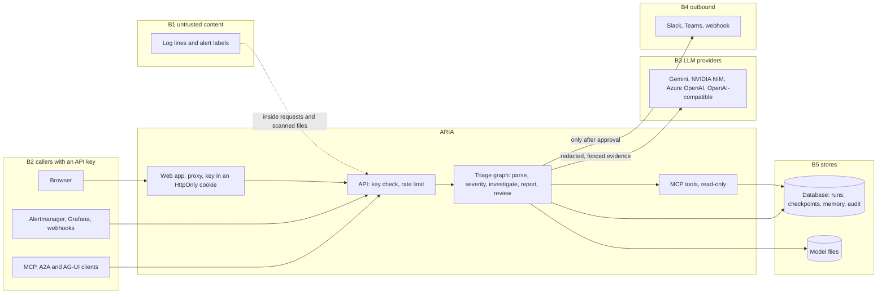

# Threat model

This document covers four things:

- what ARIA protects;
- who might attack it;
- where its trust boundaries are;
- which controls in the code answer each threat.

Every control links to the code that implements it and the test that checks it, and the table says when no test exists. Risks that are open, or only partly covered, are listed under [Residual risks](#residual-risks) with suggested fixes.

**Scope.** This document covers the code in this repository:

- the API and workers ([`src/aria`](../src/aria));
- the web app ([`web/`](../web));
- the container images ([`Dockerfile`](../Dockerfile));
- docker compose ([`compose.yaml`](../compose.yaml));
- the Azure templates ([`infra/`](../infra));
- the GitHub workflows ([`.github/workflows`](../.github/workflows)).

**Method.** The analysis lists assets and actors, draws the trust boundaries, then works through STRIDE (spoofing, tampering, repudiation, information disclosure, denial of service, elevation of privilege) at each boundary. Each threat is mapped to the [OWASP Top 10 for LLM Applications 2025](https://genai.owasp.org/llm-top-10/).

How to run ARIA safely is in the [ops runbook](ops-runbook.md). The data and models are described in the [data card](data-card.md) and the [model card](model-card.md). Design decisions are recorded in the [ADRs](adr/README.md).

## Assets

| Asset | Where it lives | Why it matters |
|---|---|---|
| Log lines and alert content | Request bodies, scanned log files, and the database (run records, checkpoints, analysed lines) | They can hold personal data, credentials and text an attacker wrote |
| API keys | `ARIA_API_KEYS` (environment or Key Vault), and the web console's HttpOnly cookie | Every valid key has full access |
| LLM provider keys | `GEMINI_API_KEY`, `NVIDIA_API_KEY`, `AZURE_OPENAI_API_KEY`, `OPENAI_API_KEY` | They spend money or free-tier quota on the deployment's provider account |
| Pseudonym key | `ARIA_PSEUDONYM_KEY` (environment or Key Vault); without it, a random key ARIA keeps in the database | With it, anyone can test candidate IP and e-mail addresses against the pseudonyms |
| Incident memory | Database; retrieved as evidence in later runs | Poisoned memory misleads future triage |
| Severity model files | `models/severity_log.json`, the versions kept beside it, `embed_local.npz` | They decide which incidents skip human review |
| Reports, reviews and the tool-call audit | Database | The record of what ARIA claimed, which tools it called and who approved it |
| Outbound channels | Slack, Teams and webhook URLs in the environment | Messages reach people outside the team |

## Actors

| Actor | What they can do | What they might want |
|---|---|---|
| Anyone who can write a log line | Put text into user agents, usernames, request paths, error messages and alert labels | Lower a severity, suppress paging, make ARIA call tools or leak data |
| API callers | Anything an API key allows, which is everything | Abuse, or mistakes such as huge payloads and raised budgets |
| Webhook senders | POST alert payloads with a key | Alert storms and malformed payloads |
| MCP and A2A clients | Read evidence through MCP tools; submit and review runs through A2A | Read more than they should, or approve their own runs |
| A compromised or misbehaving LLM provider | Return any text | Invent evidence, numbers or severities, or emit harmful text |
| A malicious or careless reviewer | Approve, edit or reject reports and outbound messages | Publish wrong reports, or poison memory and calibration |
| A supply-chain attacker | Publish packages, GitHub Actions, images or dataset files | Run code in CI or in the containers, or skew training data |

## Trust boundaries

| Boundary | What crosses it |
|---|---|
| B1 untrusted content | Log lines and alert values, carried inside authenticated requests or read from files the log scan tails |
| B2 callers to ARIA | The browser (through the web app's proxy), webhook senders, and MCP, A2A and AG-UI clients |
| B3 ARIA to LLM providers | Redacted, fenced evidence going out; model text coming back |
| B4 ARIA to outbound channels | Messages a reviewer approved |
| B5 ARIA to its stores | The database, model files and data volumes |
| B6 build and deploy | Dependencies, base images, dataset downloads, workflows and the cloud identity (not drawn) |

## Threats by boundary

### B1 untrusted content

| ID | Threat | STRIDE | OWASP LLM 2025 |
|---|---|---|---|
| T1 | Text in a log line or alert label tells a model to lower the severity, skip review, call tools or reveal data | Tampering, elevation of privilege | LLM01 prompt injection, LLM06 excessive agency |
| T2 | Secrets and personal data in logs reach the LLM provider, the console, traces or incident memory | Information disclosure | LLM02 sensitive information disclosure |
| T3 | Injected lines reshape the templates or features that decide severity | Tampering | LLM01 prompt injection |
| T4 | A flood of lines, very long lines or an alert storm exhausts memory, workers or the LLM budget | Denial of service | LLM10 unbounded consumption |

### B2 callers to ARIA

| ID | Threat | STRIDE | OWASP LLM 2025 |
|---|---|---|---|
| T5 | Someone without a key reads runs, reports, memory or metrics, or starts runs | Spoofing, information disclosure | |
| T6 | A reviewer's name in the audit trail is forged | Spoofing, repudiation | |
| T7 | Another site makes a signed-in browser act on ARIA (CSRF) | Spoofing, tampering | |
| T8 | Markup in a report or runbook runs script in the console (XSS) | Tampering, elevation of privilege | LLM05 improper output handling |
| T9 | Request floods exhaust the API or the workers | Denial of service | LLM10 unbounded consumption |
| T10 | A caller turns off human review, or raises their run's budgets | Elevation of privilege, denial of service | LLM06 excessive agency, LLM10 unbounded consumption |
| T11 | A web page open in an operator's browser reaches the MCP endpoint through DNS rebinding | Spoofing | |
| T29 | A visitor's own model key leaks (stored, logged, shown to another visitor or sent anywhere but its provider), or answers someone else's work | Information disclosure, elevation of privilege | LLM02 sensitive information disclosure, LLM10 unbounded consumption |
| T30 | On a shared public demo, one visitor reads, changes or deletes another visitor's incidents, or plants an incident every visitor sees | Information disclosure, tampering | LLM02 sensitive information disclosure |

### B3 ARIA to LLM providers

| ID | Threat | STRIDE | OWASP LLM 2025 |
|---|---|---|---|
| T12 | The model returns well-formed but false content: invented evidence IDs, numbers or causes, or a severity the evidence does not support | Tampering | LLM09 misinformation, LLM05 improper output handling |
| T13 | The model writes harmful text into a report or a message | Tampering | LLM05 improper output handling |
| T14 | A provider is down, slow or rate-limited, and runs stall | Denial of service | LLM10 unbounded consumption |
| T15 | A run spends without limit (tokens, calls, time) | Denial of service | LLM10 unbounded consumption |
| T16 | The system prompt leaks | Information disclosure | LLM07 system prompt leakage |
| T17 | Output from the offline fake provider is passed off as model output in production | Tampering | LLM09 misinformation |

### B4 ARIA to outbound channels

| ID | Threat | STRIDE | OWASP LLM 2025 |
|---|---|---|---|
| T18 | ARIA sends a message nobody approved, or sends it to an address an attacker chose | Elevation of privilege, information disclosure | LLM06 excessive agency |
| T19 | Investigator tool calls change or delete something | Tampering, elevation of privilege | LLM06 excessive agency |
| T20 | A message to stakeholders or customers leaks internal identifiers, credentials or speculation | Information disclosure | LLM02 sensitive information disclosure, LLM05 improper output handling |

### B5 ARIA to its stores

| ID | Threat | STRIDE | OWASP LLM 2025 |
|---|---|---|---|
| T21 | A wrong or malicious report enters incident memory and misleads later runs | Tampering | LLM04 data and model poisoning, LLM08 vector and embedding weaknesses |
| T22 | Reviews skew the severity model's calibration | Tampering | LLM04 data and model poisoning |
| T23 | A tampered model file runs code when loaded, or changes decisions | Tampering, elevation of privilege | LLM03 supply chain, LLM04 data and model poisoning |
| T24 | Raw logs and secrets sit readable in the database | Information disclosure | LLM02 sensitive information disclosure |
| T25 | Secrets end up in config files, images, logs or git | Information disclosure | |

### B6 build and deploy

| ID | Threat | STRIDE | OWASP LLM 2025 |
|---|---|---|---|
| T26 | A malicious or vulnerable dependency, GitHub Action or base image runs code in CI or in production | Tampering, elevation of privilege | LLM03 supply chain |
| T27 | A tampered public dataset skews training or evaluation | Tampering | LLM04 data and model poisoning |
| T28 | Stolen cloud credentials deploy code or read secrets | Spoofing, elevation of privilege | |

## Controls

| Threat | Control | Code | Test |
|---|---|---|---|
| T1 | A detector flags lines that read as instructions to a model. It also checks each line after undoing URL encoding, leetspeak, base64, zero-width characters and full-width forms. The parser quarantines flagged lines. | [`security/injection.py`](../src/aria/security/injection.py), [`parsing/parser.py`](../src/aria/parsing/parser.py) | [`test_guards.py`](../tests/unit/test_guards.py): `test_injection_attempts_are_flagged`, `test_normalisation_defeats_unicode_evasion`, `test_ordinary_log_lines_are_not_flagged` |
| T1 | Untrusted text reaches a model only inside an `<untrusted_…>` fence, under rules that say it is data. That includes ARIA's own drafts, claims, investigation notes and search terms whenever they quote logs, alerts or tickets: they travel as fenced data, and ARIA's context block holds only what it computed itself. The text cannot close the fence or forge the context block. When a run is created, its title, service, alerts and ticket fields are redacted, pseudonymised and kept to one line, and a fork's new title is cleaned the same way, so no checkpoint or run list holds them raw. | [`llm/prompts.py`](../src/aria/llm/prompts.py), [`security/injection.py`](../src/aria/security/injection.py), [`security/fields.py`](../src/aria/security/fields.py), [`graph/runner.py`](../src/aria/graph/runner.py) | [`test_llm_prompts.py`](../tests/unit/test_llm_prompts.py): `test_untrusted_text_cannot_escape_the_fence_or_forge_context`, `test_facts_cannot_close_the_context_block`, `test_drafts_that_quote_logs_travel_fenced_not_in_the_context`; [`test_reporting.py`](../tests/unit/test_reporting.py): `test_the_report_writer_sends_its_draft_fenced`; [`test_guards.py`](../tests/unit/test_guards.py): `test_fence_cannot_be_closed_from_inside`; [`test_api.py`](../tests/unit/test_api.py): `test_no_checkpoint_or_list_holds_a_raw_title_alert_or_ticket` |
| T1 | Rules and the calibrated model decide severity. An LLM may choose only inside the conformal prediction set, and never below a rule floor: its schema offers only those classes, and its answer is checked again. | [`severity/policy.py`](../src/aria/severity/policy.py), [`severity/adjudicator.py`](../src/aria/severity/adjudicator.py), [`llm/jsonschema.py`](../src/aria/llm/jsonschema.py) | [`test_severity.py`](../tests/unit/test_severity.py): `test_a_compromised_llm_cannot_leave_the_prediction_set`, `test_llm_choice_must_be_inside_the_set`; [`test_llm_prompts.py`](../tests/unit/test_llm_prompts.py): `test_restrict_enum_narrows_severity_to_the_prediction_set` |
| T1 | Injected lines change neither the severity nor the investigator's tool calls. This is checked end to end. | [`graph/workflow.py`](../src/aria/graph/workflow.py) | [`test_workflow.py`](../tests/unit/test_workflow.py): `test_injected_lines_change_neither_severity_nor_tool_use` |
| T1 | Alert label and annotation sizes are capped. When a run starts, every alert name, label and annotation, the title, the service and the environment are cleaned once for every later step: secrets are redacted, addresses get the run's pseudonyms, and a value that reads like an instruction is withheld whole (a title that does is dropped, and the report writes its own). Report titles and claims, outbound drafts, model prompts and the state endpoint only ever see the cleaned values. | [`security/fields.py`](../src/aria/security/fields.py), [`graph/workflow.py`](../src/aria/graph/workflow.py) (`plan`) | [`test_workflow.py`](../tests/unit/test_workflow.py): `test_alerts_become_evidence_and_instruction_text_is_withheld`, `test_alert_fields_are_cleaned_before_reports_drafts_or_state_see_them` |
| T2 | Alert secrets are redacted as a webhook arrives, before the alert or its run title is stored, and a label whose name marks a secret (`token`, `api_key`) is redacted whole. The redactor replaces these with `[REDACTED]`: private keys (also when printed over many lines, which shards never split), JWTs; AWS, NVIDIA, OpenAI, Google, Stripe and SendGrid keys; GitHub, GitLab and Slack tokens, and Slack webhook paths; bearer tokens and Basic credentials; credentials in URLs; Luhn-valid card numbers; and the value of any setting whose name holds a secret (`password=…`, `DB_PASSWORD=…`, `"api_key": "…"`, `AccountKey=…`, `--password …`, a SAS `sig=`). IP addresses (IPv4, and IPv6 in full or compressed form) and e-mail addresses become keyed pseudonyms, which are stable within a run and unlinkable across runs. Every process uses the same key, so the API cleaning an alert and a worker parsing the logs name a host the same way. | [`security/redaction.py`](../src/aria/security/redaction.py), [`graph/workflow.py`](../src/aria/graph/workflow.py) (`run_salt`) | [`test_api.py`](../tests/unit/test_api.py): `test_alert_secrets_are_redacted_before_anything_stores_them`; [`test_guards.py`](../tests/unit/test_guards.py): `test_secrets_are_removed`, `test_secret_formats_that_used_to_slip_through_are_removed`, `test_a_private_key_printed_over_several_lines_is_removed`, `test_shards_never_split_a_private_key`, `test_ips_and_emails_are_pseudonymised_consistently`, `test_a_long_run_of_address_characters_is_redacted_in_linear_time`, `test_ipv6_addresses_are_pseudonymised_compressed_or_not`, `test_redaction_is_total_and_idempotent`; [`test_parsing.py`](../tests/unit/test_parsing.py): `test_templates_do_not_depend_on_the_pseudonym_key`; [`test_workflow.py`](../tests/unit/test_workflow.py): `test_processes_with_no_configured_key_share_one_pseudonym_key` |
| T2 | Traces carry no prompt or completion text unless `ARIA_OTEL_CAPTURE_CONTENT=true`. | [`observability/tracing.py`](../src/aria/observability/tracing.py) | [`test_tracing.py`](../tests/unit/test_tracing.py): `test_llm_calls_emit_genai_chat_spans_without_content`, `test_content_capture_is_opt_in` |
| T2 | The report validator rejects text in claims and titles that looks like a credential. | [`reporting/grounding.py`](../src/aria/reporting/grounding.py) | [`test_reporting.py`](../tests/unit/test_reporting.py): `test_validator_catches_every_kind_of_defect` |
| T3 | Quarantined lines never reach the template miner or the features, and the run's stored lines never include them. | [`parsing/parser.py`](../src/aria/parsing/parser.py), [`retrieval/runlog.py`](../src/aria/retrieval/runlog.py) | [`test_parsing.py`](../tests/unit/test_parsing.py): `test_quarantined_lines_change_no_template_or_feature`, `test_injected_line_is_flagged_redacted_and_kept_as_evidence`; [`test_mcp.py`](../tests/unit/test_mcp.py): `test_run_lines_never_store_quarantined_text`; [`test_investigator.py`](../tests/unit/test_investigator.py): `test_quarantined_lines_never_choose_the_component` |
| T4 | The API refuses request bodies over `ARIA_MAX_BODY_BYTES` (48 MiB by default) with 413, declared or streamed. One webhook payload stores at most 500 alerts of 64 labels each. Each run analyses at most `guardrails.max_lines` lines, each cut to `max_line_chars`. Alerts that share a group key within the grouping window join one run, also when deliveries race on several replicas: the database keeps one open group per key (a unique index), and every request tries the group's run IDs in the same order. The log scan reads a bounded amount per poll and opens at most one run per system per window. | [`api/security.py`](../src/aria/api/security.py) (`BodyLimit`), [`graph/workflow.py`](../src/aria/graph/workflow.py) (`plan`), [`parsing/parser.py`](../src/aria/parsing/parser.py), [`api/alerts.py`](../src/aria/api/alerts.py), [`api/scan.py`](../src/aria/api/scan.py) | [`test_api.py`](../tests/unit/test_api.py): `test_guessed_keys_are_rate_limited_and_huge_bodies_refused`, `test_one_alert_payload_cannot_store_unbounded_alerts_or_labels`, `test_alert_storms_become_one_grouped_run`, `test_two_replicas_opening_one_alert_group_at_once_share_it`, `test_a_burst_of_deliveries_for_one_new_group_opens_one_run`, `test_another_run_holding_the_group_run_id_moves_the_storm_to_the_next_id`, `test_a_request_that_arrives_late_joins_the_run_it_raced_for`, `test_the_migration_keeps_one_open_group_per_key`; [`test_parsing.py`](../tests/unit/test_parsing.py): `test_guard_caps_lines_and_truncates_long_ones`; [`test_scan.py`](../tests/unit/test_scan.py): `test_reads_are_bounded_and_an_endless_line_is_skipped`, `test_a_finding_opens_one_run_until_its_system_is_quiet` |
| T5 | With keys configured, one ASGI middleware requires an API key on `/api/`, `/mcp`, `/a2a`, `/agui` and `/metrics`, and compares keys in constant time. It checks the path routing serves, so a proxy prefix (an ASGI root path) cannot step around it. Production refuses to start without keys, or with a secret shorter than 32 characters. Each request to a protected path leaves an access-log line with the key's name. In dev and test an API with no keys is open, so compose publishes its ports on 127.0.0.1 only. | [`api/security.py`](../src/aria/api/security.py), [`api/app.py`](../src/aria/api/app.py), [`compose.yaml`](../compose.yaml) | [`test_api.py`](../tests/unit/test_api.py): `test_health_is_public_and_everything_else_needs_a_key`, `test_production_refuses_to_start_without_keys`, `test_production_refuses_keys_short_enough_to_guess`, `test_a_proxy_prefix_does_not_open_protected_paths`, `test_every_protected_request_leaves_an_access_log_line` |
| T6 | With keys configured, REST reviews, AG-UI resumes and A2A replies take the reviewer's name from the API key, not from the request body or message. | [`api/routers/runs.py`](../src/aria/api/routers/runs.py), [`api/agui.py`](../src/aria/api/agui.py), [`api/a2a.py`](../src/aria/api/a2a.py) (`reviewer_for`) | [`test_api.py`](../tests/unit/test_api.py): `test_run_lifecycle_over_http`, `test_a2a_task_pauses_for_review_and_completes` |
| T7 | The console keeps the API key in an HttpOnly, SameSite=Strict cookie scoped to `/api`. Its proxy refuses cross-site writes and path traversal. It forwards only listed headers each way, and drops the browser's own `Authorization` header. It refuses bodies over 8 MB. | [`upstream.ts`](../web/src/lib/server/upstream.ts), [`session/route.ts`](../web/src/app/api/session/route.ts) | [`upstream.test.ts`](../web/src/lib/server/upstream.test.ts), [`session/route.test.ts`](../web/src/app/api/session/route.test.ts) |
| T8 | Markdown from ARIA renders with raw HTML skipped. A Content-Security-Policy limits scripts, styles, images and connections to the site's own origin, and forbids framing. | [`markdown.tsx`](../web/src/components/ui/markdown.tsx), [`next.config.ts`](../web/next.config.ts) | [`markdown.test.tsx`](../web/src/components/ui/markdown.test.tsx): `renders Markdown but never raw HTML from logs` |
| T9 | A token bucket per key answers 429 with `Retry-After`. Failed sign-ins spend the caller's address bucket, at `/readyz` as everywhere else, so keys cannot be guessed quickly; on Azure the API trusts the address its ingress forwards (`FORWARDED_ALLOW_IPS`, private ranges only, so a caller cannot write its own), and the limiter forgets callers once their bucket has refilled, so many addresses cannot grow it without bound. Event cursors are bounded, so a huge one is a 422, not a database error. Runs execute a few at a time, and the external worker finishes the runs in hand when the platform stops it. | [`api/security.py`](../src/aria/api/security.py), [`api/routers/runs.py`](../src/aria/api/routers/runs.py), [`api/worker.py`](../src/aria/api/worker.py), [`cli.py`](../src/aria/cli.py) (`worker`), [`infra/resources.bicep`](../infra/resources.bicep) | [`test_api.py`](../tests/unit/test_api.py): `test_rate_limit_answers_429_with_retry_after`, `test_the_rate_limiter_forgets_idle_callers_without_changing_an_answer`, `test_guessed_keys_are_rate_limited_and_huge_bodies_refused`, `test_run_lifecycle_over_http` |
| T10 | A run publishes without review only when both the server (`ARIA_REQUIRE_APPROVAL=false`) and the run ask for it. Even then, nothing is sent outbound. A run's own token and cost limits can only lower the configured ones. | [`graph/workflow.py`](../src/aria/graph/workflow.py) (`review`, `_limits`) | [`test_workflow.py`](../tests/unit/test_workflow.py): `test_unattended_runs_publish_without_sending_anything`, `test_a_request_can_tighten_its_budgets_but_never_raise_them` |
| T11 | The mounted MCP endpoint accepts only localhost, the host of `ARIA_PUBLIC_BASE_URL` and the configured CORS origins. | [`api/app.py`](../src/aria/api/app.py) (`_allowed_hosts`) | [`test_api.py`](../tests/unit/test_api.py): `test_the_mcp_endpoint_refuses_other_hosts_and_origins` |
| T12 | Structured output is checked against strict schemas, with one repair attempt before the next provider. Every claim, timeline entry and action must cite existing evidence, and every number must appear in the evidence it cites. A critic removes claims their evidence does not support. A report that fails validation is replaced by the grounded draft. | [`llm/router.py`](../src/aria/llm/router.py), [`reporting/grounding.py`](../src/aria/reporting/grounding.py), [`reporting/writer.py`](../src/aria/reporting/writer.py) | [`test_llm_router.py`](../tests/unit/test_llm_router.py): `test_invalid_output_gets_one_repair_with_the_errors`; [`test_reporting.py`](../tests/unit/test_reporting.py): `test_a_hallucinating_llm_falls_back_to_the_grounded_draft`, `test_the_critic_removes_claims_its_evidence_does_not_support`; [`test_severity.py`](../tests/unit/test_severity.py): `test_llm_citing_unknown_evidence_is_rejected` |
| T13 | An optional content-safety model reads LLM-written report claims and polished messages. A flagged, unreadable or unanswered check keeps the deterministic text, so the check fails closed. It is off by default. | [`security/safety.py`](../src/aria/security/safety.py), [`reporting/writer.py`](../src/aria/reporting/writer.py), [`reporting/comms.py`](../src/aria/reporting/comms.py) | [`test_safety.py`](../tests/unit/test_safety.py); [`test_reporting.py`](../tests/unit/test_reporting.py): `test_the_safety_guardrail_keeps_flagged_llm_text_out` |
| T14 | Each role has a chain of fallback providers, and each provider a circuit breaker; a timeout opens the breaker at once, and for longer. A streamed response that stalls fails over. When every provider fails, the run takes its deterministic path. | [`llm/router.py`](../src/aria/llm/router.py), [`llm/openai_compat.py`](../src/aria/llm/openai_compat.py) | [`test_llm_router.py`](../tests/unit/test_llm_router.py): `test_falls_back_to_next_provider_and_records_attempts`, `test_circuit_breaker_opens_then_half_opens`, `test_a_timeout_trips_the_breaker_at_once_and_for_longer`; [`test_llm_providers.py`](../tests/unit/test_llm_providers.py): `test_a_stalled_stream_fails_over_without_retrying` |
| T15 | A budget guard checks tokens, cost, LLM calls and elapsed time before every LLM call, and checks tool calls and steps as they happen. An exhausted budget sends the run down its deterministic path instead of failing it. | [`llm/budget.py`](../src/aria/llm/budget.py), [`mcp/client.py`](../src/aria/mcp/client.py) | [`test_llm_router.py`](../tests/unit/test_llm_router.py): `test_budget_guard_checks_every_limit`, `test_budget_guard_enforces_wall_clock`; [`test_workflow.py`](../tests/unit/test_workflow.py): `test_exhausted_budget_falls_back_without_failing` |
| T16 | Prompts hold no secrets: provider keys travel only in HTTP headers, read from the environment or, for a visitor's own key, from the request it came with. The prompts are published in this repository, so a leak reveals nothing private. The detector flags log lines that ask for the system prompt. | [`llm/prompts.py`](../src/aria/llm/prompts.py), [`llm/openai_compat.py`](../src/aria/llm/openai_compat.py), [`security/injection.py`](../src/aria/security/injection.py) | The edge-case suite's prompt-leak family ([evaluation](evaluation.md#edge-cases-and-prompt-injection)) |
| T17 | In production the router never enables the fake provider. | [`llm/router.py`](../src/aria/llm/router.py) | [`test_llm_router.py`](../tests/unit/test_llm_router.py): `test_production_never_uses_the_fake_provider` |
| T18 | Messages are proposals, and only actions a reviewer approves by ID are sent. Destinations come only from environment variables, never from a request or a model, and must be HTTPS (plain HTTP only to localhost). Each delivery carries an idempotency key, and the generic webhook is HMAC-signed. An action already sent is never sent again: each is marked as being sent before it goes out, and only one process at a time can drive a run (a claim each drive takes and renews), so a review applied long after the pause cannot be published twice. **Send again** takes only a message a reviewer approved that did not go out: one whose delivery failed, or one a stopped process left marked as being sent. It holds the run's claim as a drive does, so it never races a publish, and it cannot send an unapproved message or one recorded as sent. A message left marked as being sent may have gone out, so the run page says its delivery was not confirmed, and the resend carries the same idempotency key. Slack text has `&`, `<` and `>` escaped, so text from logs cannot mention a channel or forge a link. | [`graph/workflow.py`](../src/aria/graph/workflow.py) (`publish`), [`graph/runner.py`](../src/aria/graph/runner.py) (`resend`), [`notify.py`](../src/aria/notify.py) | [`test_workflow.py`](../tests/unit/test_workflow.py): `test_approved_webhook_action_is_signed_and_sent_once`, `test_a_review_long_after_the_pause_is_published_by_one_process_only`, `test_an_approved_message_is_claimed_for_sending_once`, `test_rejected_run_sends_nothing_and_records_feedback`, `test_a_failed_delivery_can_be_sent_again_and_nothing_else_can`, `test_a_message_left_mid_send_can_be_sent_again_once_no_process_holds_its_run`, `test_a_recovered_run_already_at_review_gives_its_claim_up`; [`test_api.py`](../tests/unit/test_api.py): `test_only_one_process_drives_a_run_until_it_lets_go_or_goes_quiet`, `test_free_runs_are_claimed_past_runs_other_processes_hold`, `test_a_stream_cancelled_before_its_run_starts_gives_the_run_up`, `test_giving_a_run_up_waits_for_whatever_holds_it_for_a_moment`, `test_a_worker_with_no_free_slot_leaves_abandoned_runs_to_the_others`; [`test_notify.py`](../tests/unit/test_notify.py): `test_plain_http_is_refused_except_on_localhost`, `test_already_sent_actions_are_never_resent`, `test_slack_text_cannot_mention_everyone_or_link` |
| T19 | Every MCP tool is annotated read-only, idempotent and closed-world, and its arguments are bounded. The agents' tool belt shows only allowlisted tools and drops undeclared arguments. It checks the run's tool budget, and writes an audit record for every call. | [`mcp/server.py`](../src/aria/mcp/server.py), [`mcp/client.py`](../src/aria/mcp/client.py) | [`test_mcp.py`](../tests/unit/test_mcp.py): `test_every_tool_is_read_only_and_annotated`, `test_bad_arguments_are_rejected_by_the_server`, `test_tool_belt_enforces_allowlist_budget_and_audit`; [`test_investigator.py`](../tests/unit/test_investigator.py): `test_off_list_actions_and_unknown_evidence_fall_back_to_the_plan` |
| T20 | Drafts for stakeholders and customers are checked for pseudonyms, IP addresses, evidence and template IDs, node and internal host names, file paths, credentials, instruction-like text, links and phone numbers. Customer updates are also checked for speculation about the cause. A polished draft that fails a check is replaced by the deterministic one. A link includes a bare domain such as `status-help.com`. The deterministic drafts name the service only when its label reads as a name and would pass these checks itself (a few words, no sentence, link, host name or markup); otherwise they use the system's name, so text slipped into an alert label never reaches customers. | [`reporting/grounding.py`](../src/aria/reporting/grounding.py) (`validate_external_text`), [`reporting/comms.py`](../src/aria/reporting/comms.py) (`is_service_name`), [`graph/workflow.py`](../src/aria/graph/workflow.py) (`service_name`) | [`test_reporting.py`](../tests/unit/test_reporting.py): `test_external_text_rules`, `test_comms_are_proposals_and_leaky_polish_is_rejected`; [`test_workflow.py`](../tests/unit/test_workflow.py): `test_a_service_label_that_is_not_a_name_never_reaches_a_message`, `test_updates_outside_the_team_carry_no_links_or_phone_numbers` |
| T21 | Only published reports enter memory: ones a reviewer approved, or unattended runs the operator allowed. Memory comes back to models as fenced, untrusted evidence. Seeded incidents are labelled synthetic. Deleting a run removes its memory entry, and every process (API or worker) drops it within a minute, since each checks for incidents other processes added, changed or removed. | [`graph/workflow.py`](../src/aria/graph/workflow.py) (`publish`), [`graph/runner.py`](../src/aria/graph/runner.py) (`delete`) | [`test_workflow.py`](../tests/unit/test_workflow.py): `test_run_pauses_for_review_then_publishes_a_cited_report`, `test_delete_removes_the_run_everywhere`; [`test_retrieval.py`](../tests/unit/test_retrieval.py): `test_memory_in_another_process_follows_publishes_and_deletes`, `test_memory_reloads_for_edits_whatever_the_clock_and_not_for_embeddings` |
| T22 | Recalibration counts only approvals and edits, and waits for `severity.recalibrate_after` new reviews (never fewer than 10). It moves only the conformal threshold, never the coefficients, and keeps the previous model file. Rule floors still apply. | [`severity/recalibration.py`](../src/aria/severity/recalibration.py), [`config.py`](../src/aria/config.py) | [`test_recalibration.py`](../tests/unit/test_recalibration.py) |
| T23 | Model files are JSON, and NumPy archives loaded without pickle. The loader rejects corrupt files and models with the wrong classes, and recalibration writes atomically. | [`severity/model.py`](../src/aria/severity/model.py), [`llm/local_embed.py`](../src/aria/llm/local_embed.py), [`severity/engine.py`](../src/aria/severity/engine.py) | [`test_severity.py`](../tests/unit/test_severity.py): `test_corrupt_model_files_are_rejected`, `test_engine_rejects_models_with_other_classes`; [`test_local_embed.py`](../tests/unit/test_local_embed.py): `test_lsa_round_trips_through_npz_without_pickle` |
| T24 | Analysed lines are stored redacted, and quarantined lines are not stored at all. The state endpoint replaces raw input lines with a count. `DELETE /api/v1/runs/{run_id}` purges a run's checkpoints, lines, events, report, actions, audit records and memory entry. Azure SQL accepts only Entra ID sign-in over TLS 1.2 or later, and has no password. | [`retrieval/runlog.py`](../src/aria/retrieval/runlog.py), [`api/routers/runs.py`](../src/aria/api/routers/runs.py) (`_public_state`), [`graph/runner.py`](../src/aria/graph/runner.py) (`delete`), [`infra/resources.bicep`](../infra/resources.bicep) | [`test_mcp.py`](../tests/unit/test_mcp.py): `test_run_lines_never_store_quarantined_text`; [`test_workflow.py`](../tests/unit/test_workflow.py): `test_delete_removes_the_run_everywhere` |
| T25 | Config names the environment variable that holds each key, never the key itself. Settings hold secrets as `SecretStr`, and a blank value counts as unset. The settings and provider endpoints never return keys. On Azure, secrets live in Key Vault (RBAC, soft delete, purge protection), and the apps read them with a managed identity. The build CA is a build secret that no image layer keeps. Tests never load `.env`. | [`config.py`](../src/aria/config.py), [`config/aria.yaml`](../config/aria.yaml), [`api/routers/system.py`](../src/aria/api/routers/system.py), [`infra/resources.bicep`](../infra/resources.bicep), [`Dockerfile`](../Dockerfile) | [`test_config.py`](../tests/unit/test_config.py): `test_blank_secrets_count_as_unset`, `test_providers_without_credentials_are_disabled`; [`test_api.py`](../tests/unit/test_api.py): `test_me_and_settings_show_the_caller_and_limits_without_secrets` |
| T26 | Dependencies are locked (`uv.lock`, a frozen pnpm lockfile). pnpm resolves no version younger than a week, and runs no install scripts. Dependabot covers uv, npm (with a cooldown), GitHub Actions and Docker. CI runs pip-audit and pnpm audit. Actions are pinned to commit SHAs, checked by actionlint and zizmor, and run with read-only tokens and no persisted credentials. Containers run as an unprivileged user. | [`pnpm-workspace.yaml`](../web/pnpm-workspace.yaml), [`dependabot.yml`](../.github/dependabot.yml), [`ci.yml`](../.github/workflows/ci.yml), [`Dockerfile`](../Dockerfile) | The CI jobs in [`ci.yml`](../.github/workflows/ci.yml) |
| T27 | Dataset downloads are pinned: git sources to commits, Zenodo files to their MD5, other files to a SHA-256 recorded on first download and enforced after, and mirrors to their own SHA-256 or commit. The one exception is GitLab.com's incident tracker, a live API: its download records the snapshot's SHA-256 and date for the evaluation to quote, but cannot pin it (see residual risks). Archives that try to write outside their folder are refused. | [`data/download.py`](../src/aria/data/download.py), [`data/manifest.yaml`](../data/manifest.yaml) | [`test_download.py`](../tests/unit/test_download.py): `test_repo_manifest_is_valid_and_pins_git_commits`, `test_zenodo_checksum_mismatch_is_rejected`, `test_http_download_pins_checksum_on_first_use_then_enforces_it`, `test_zip_slip_is_refused` |
| T29 | Visitors' own keys are off unless `ARIA_VISITOR_KEYS=true` and runs execute in the API process. A key arrives in `X-Model-Key` with a request that can call a model, must look like a plain token (so it cannot break a header), and fills only providers whose endpoint and model come from config. The API holds it in memory until the run it came with starts; that run gets a router of its own whose clients and circuit breakers no other request shares, and which is closed when the run stops, so the key never answers anyone else's work or labels the server's providers. It never joins the stored request, events, checkpoints or logs, and a provider error that echoes it is scrubbed. Claude's client is given the key explicitly, so the SDK never adds credentials from the environment. The console keeps it in an HttpOnly, SameSite=Strict cookie scoped to `/api` for a working day, sets it only after the provider accepts it, shows pages only its provider and last four characters, and forwards it only with requests that can call a model. A run's budget caps what one run can spend from it. | [`api/keys.py`](../src/aria/api/keys.py), [`llm/visitor.py`](../src/aria/llm/visitor.py), [`llm/router.py`](../src/aria/llm/router.py) (`with_key`), [`llm/claude.py`](../src/aria/llm/claude.py), [`graph/runner.py`](../src/aria/graph/runner.py) (`_stream`), [`upstream.ts`](../web/src/lib/server/upstream.ts), [`model-key/route.ts`](../web/src/app/api/model-key/route.ts) | [`test_visitor_keys.py`](../tests/unit/test_visitor_keys.py): `test_a_visitors_key_answers_their_run_and_is_stored_nowhere`, `test_a_key_view_leads_with_its_providers_and_keeps_its_failures_to_itself`, `test_a_provider_that_echoes_the_key_never_gets_it_into_an_error`, `test_a_bad_key_or_provider_is_refused_without_repeating_it`, `test_a_separate_worker_process_means_no_visitor_keys`, `test_only_a_plain_token_counts_as_a_key`; [`upstream.test.ts`](../web/src/lib/server/upstream.test.ts); [`model-key/route.test.ts`](../web/src/app/api/model-key/route.test.ts) |
| T30 | With `ARIA_VISITOR_SCOPE=true`, the console gives each browser a random session id in an HttpOnly, SameSite=Strict cookie scoped to `/api` and sends it as `X-Visitor-Id`. A run records a hash of the id, never the id itself. Every run route, Ask ARIA about a run, AG-UI threads, A2A tasks and the open `/mcp` endpoint's run tools see only the caller's runs and the examples the server started itself, and another visitor's run reads as missing (404). Alerts group per visitor. Nobody may review, resend or delete an example; forking one makes a private copy. Callers that send no id share one anonymous space, so their runs never become examples, and a caller with an API key sees every run. A visitor's runs never join incident memory, the template store or the reviews that recalibrate the model. | [`api/visitors.py`](../src/aria/api/visitors.py), [`api/routers/runs.py`](../src/aria/api/routers/runs.py), [`api/agui.py`](../src/aria/api/agui.py), [`api/a2a.py`](../src/aria/api/a2a.py), [`mcp/server.py`](../src/aria/mcp/server.py) (`readable`), [`graph/workflow.py`](../src/aria/graph/workflow.py) (`_private`), [`upstream.ts`](../web/src/lib/server/upstream.ts) | [`test_visitor_scope.py`](../tests/unit/test_visitor_scope.py); [`upstream.test.ts`](../web/src/lib/server/upstream.test.ts); [`demo.spec.ts`](../web/e2e/demo.spec.ts) |
| T28 | The deploy workflow runs only by hand, in a GitHub environment, and signs in to Azure with OpenID Connect, so no Azure credentials are stored. The registry has no admin user. The apps pull images and read secrets with a managed identity. | [`deploy.yml`](../.github/workflows/deploy.yml), [`infra/resources.bicep`](../infra/resources.bicep) | None beyond actionlint and zizmor |

## Residual risks

The fixes below are suggestions; none of them is built.

| Risk | Why it is open | Suggested fix |
|---|---|---|
| The injection detector misses many attacks | On its own corpus, which tuned it, recall is an upper bound ([edge cases](evaluation.md#edge-cases-and-prompt-injection)). On six public benchmarks it was never tuned on, it misses most attacks phrased as ordinary requests ([public benchmarks](evaluation.md#prompt-injection-public-benchmarks)). A missed line is analysed as an ordinary log line and reaches models only fenced, and severity cannot leave the prediction set. | Add a model-based classifier as a second opinion, and measure it on the same benchmarks |
| The content-safety model has not been called live | `nvidia/nemotron-3.5-content-safety` is in NIM's model catalog (checked 2026-10-29, and `aria providers check` now reports it), but ARIA has never sent it a request, so the verdict format it parses is unconfirmed. The guardrail is off by default and fails closed. | Send it known-safe and known-unsafe samples, and check the verdicts parse, before turning the guardrail on |
| There are no read-only or reviewer-only keys | Every valid key can submit runs, review and approve outbound messages, fork and delete runs, and read all of memory. One key can approve its own run, so duties are not separated. | Add scopes to `ARIA_API_KEYS` (read, submit, review), and require a different key to approve than the one that submitted |
| Rate limiting is per process | Buckets live in memory, so each replica keeps its own, and a restart resets them. A long-lived event stream counts once. | Use a shared limiter, or a gateway in front |
| The cost limit binds only with prices | The budget guard counts cost only for providers with token prices configured, and of the shipped entries only Claude and OpenAI set them. The token, call, step and time limits still hold. | Set prices for every paid provider in `config/aria.yaml` |
| Visitors must trust a demo with their key | A visitor cannot see what a deployment does with a key: whoever runs it could change the code to keep keys. The console asks for a key the visitor can revoke, with a spending limit. | Prefer short-lived or restricted keys where a provider offers them, and revoke a key after a demo |
| Raw log lines are stored unredacted | The run record and its first checkpoint keep the request's log lines as sent (its title, service, alerts and ticket are cleaned when the run is created). The API never returns them, but anyone with database access can read them, and nothing purges old runs. | Store only the redacted batch, or encrypt the request, and add a retention job |
| One evaluation source is live | GitLab.com's production incidents come from its issues API, which cannot be pinned: issues are edited and relabelled after the fact. The download records the snapshot's SHA-256 and date, and the evaluation quotes them, but a fresh download may differ. | Keep a pinned copy of the snapshot outside git (for example as a release asset) and check its SHA-256 |
| Redaction is pattern-based | Personal names, usernames and hostnames pass through, and so does a secret in a format no pattern knows, written without a secret-like name beside it. | Add a named-entity detector (for example Presidio) and an entropy check for unnamed tokens |
| The standalone MCP server has no key check | `aria mcp --transport streamable-http` (and `python -m aria.mcp`) serves the read-only tools without authentication. It binds to 127.0.0.1 by default. | Keep it on localhost, and give remote clients the API's `/mcp`, which requires a key |
| Some endpoints are public | `/healthz`, `/readyz` and the agent card answer without a key (production serves no `/docs`, `/redoc` or `/openapi.json`, and a keyless `/readyz` says only whether ARIA is ready), and on Azure the API's ingress is public | Put the API behind a private ingress, or restrict the ingress to known networks |
| Deleting a run erases its audit trail | `DELETE` removes the tool-call audit and outbound-action records with the run, and only the access log shows that it happened | Keep a tombstone recording who deleted what, or give deletion its own key scope |
| Unattended runs write to memory | With approval off on both switches, reports publish and enter incident memory with no human check. Nothing is sent outbound. | Keep approval on, or keep unattended reports out of memory |
| One Azure identity does everything | The api, worker and web apps share one managed identity. It administers the SQL server and can read every Key Vault secret, though the web app needs neither. Azure SQL accepts connections from any Azure service (sign-in still needs Entra ID), and has no private endpoint. | Give the web app a pull-only identity and the apps a least-privilege database user, and use private networking |
| The console's CSP allows inline scripts | Pages are prerendered, so the policy cannot use per-request nonces | Use a nonce-based policy with dynamic rendering, or hash the inline scripts |
| Images are pinned by tag | Base images use tags (`python:3.13-slim`, `node:22-slim`), and the compose NIM profile defaults to `:latest`. Dependabot proposes updates, but a moved tag changes a build silently. | Pin images by digest |
| Model files are not signed | Anyone who can write the models directory can change which incidents skip review. Reviewers who approve everything narrow the prediction sets at the next recalibration. | Sign model files and check the signature on load, and alert when a recalibration narrows the sets |
| Some dataset checksums are trusted on first use | A download without a published checksum records the SHA-256 of its first download in `data/checksums.lock` and enforces it after that, so a file tampered with before the first download goes unnoticed | Publish checksums in [`data/manifest.yaml`](../data/manifest.yaml) for every source |
| Teams text is not escaped | Slack text is escaped, but Teams cards render a Markdown subset, so a link written in report text works in the card. The reviewer approves the exact text first. | Escape Markdown link syntax in Teams card text that came from logs |

## Security testing

- **Unit and integration tests.** `make test` runs every test named in the [controls table](#controls); the web unit tests run with `make web-check`.
- **Evaluation suites.** `make eval` measures the following, and [`docs/evaluation.md`](evaluation.md) reports the results:
  - prompt-injection attacks and benign look-alikes, one line at a time ([edge cases and prompt injection](evaluation.md#edge-cases-and-prompt-injection));
  - incident windows run clean and again with injected lines ([prompt-injection robustness](evaluation.md#prompt-injection-robustness));
  - whether every report claim cites existing evidence ([end to end](evaluation.md#end-to-end-offline-no-llm-steps));
  - whether real Loghub lines are mistaken for attacks ([log parsing](evaluation.md#log-parsing)).
- **The CI gate.** `make eval-smoke` fails the build on a regression in any of these, with bounds set in [`config/eval_thresholds.yaml`](../config/eval_thresholds.yaml):
  - attack recall;
  - benign false positives;
  - parser errors;
  - severity and tool use under injection;
  - quarantine of every injected line;
  - injected text in reports;
  - real lines flagged as attacks;
  - claims without citations.
- **Supply chain.** CI runs pip-audit, pnpm audit, actionlint and zizmor; `make audit` runs the Python and workflow checks locally.
- **Not covered.**
  - Nobody has penetration-tested ARIA.
  - Nothing fuzzes the HTTP API.
  - No load test exists.
  - The injection corpus and the detector come from the same authors.
